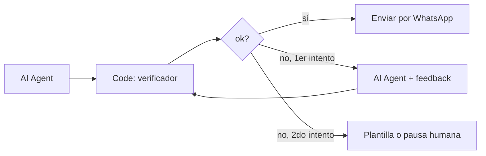

# verificador-llm

**Capa anti-alucinación para agentes de venta con IA.** Antes de que el mensaje le llegue al cliente, revisa que cada precio, moneda, metraje, link, teléfono, código y propiedad salga de tus datos, y que el agente no prometa fechas ni reservas. Si algo no cuadra, devuelve el motivo para reintentar o pasar a una persona.

Sin dependencias. Corre en Node, en un **Code node de n8n** (archivo listo para pegar) y en el navegador.

```
Hechos:  Depto Centro · USD 95.000 · 48 m2 · 2 ambientes
LLM:     "El Depto Centro sale $95.000, tiene 52 m2. Llamá al dueño al 2944 66-7788. Te lo reservo hasta el viernes."

✗ moneda     "$95.000" está en USD, no en ARS
✗ cantidad   "52 m2" no sale de los datos
✗ contacto   teléfono no provisto: 2944 66-7788
✗ promesa    promete fecha o plazo: "viernes"
✗ promesa    compromiso que el agente no puede tomar: "te lo reservo"
```

## Qué controla

| Tipo | Ejemplo bloqueado |
|---|---|
| `monto` | precio inventado o redondeado: "USD 92.000", "230k", "1,2 millones de pesos" |
| `moneda` | el precio correcto en la moneda equivocada: "$240.000" cuando es en USD |
| `cantidad` | m², ambientes, dormitorios, baños, cocheras que no figuran |
| `url` · `contacto` · `codigo` | links, teléfonos, mails o referencias que no generó el sistema |
| `entidad` | una propiedad o producto del catálogo que no corresponde a la consulta |
| `disponibilidad` | presentar como disponible algo vendido, alquilado o sin stock |
| `promesa` | fechas, plazos, "te lo reservo", "precio final" |

Entiende formatos argentinos: `USD 95.000`, `U$S 240.000`, `35 mil dólares`, `$450.000`, `1,5 millones`, `250k`, `48 m2`, `2 amb`.

## Uso

```js
import { verificar, feedback, paraVoz } from 'verificador-llm';

const hechos = {
  montos: [{ valor: 95000, moneda: 'USD' }],
  cantidades: [{ valor: 48, unidad: 'm2' }, { valor: 2, unidad: 'ambientes' }],
  entidades: ['Depto Centro'],                       // de qué puede hablar esta respuesta
  catalogo: ['Depto Centro', 'Casa Melipal'],        // todo lo que existe
  noDisponibles: [], urls: ['https://…/DC-101'], contactos: ['+54 9 2944 55-1234'],
};

const r = verificar(respuestaDelLLM, hechos);
if (!r.ok) reintentarConElLLM(feedback(r.problemas)); // un reintento; si vuelve a fallar → plantilla o persona
```

Los `hechos` se arman con **los mismos datos que devolvió la herramienta del agente** (búsqueda de propiedades, catálogo, link de pago). El verificador no busca en tu base: compara contra lo que el agente tuvo delante.

## En n8n

`n8n/verificador.code.js` es la librería completa más el wrapper. Pegalo en un Code node en modo *Run Once for Each Item*, entre el agente y el envío:



Entrada del nodo: `{ texto, hechos }`. Salida: `{ ok, problemas, feedback, voz, aparte }`.

## Voz: verificar el texto, no el audio

`paraVoz(texto)` prepara una respuesta **ya verificada** para TTS: `USD 95.000` → "noventa y cinco mil dólares", `48 m2` → "cuarenta y ocho metros cuadrados", `1 cochera` → "una cochera". Los links, mails y teléfonos salen de la voz ("el link que te paso por escrito") y vuelven en `aparte` para mandarlos como texto.

## Evaluación

```bash
npm test       # 6 tests, incluido el Code node de n8n ejecutado con $json
npm run eval   # suite de 26 casos de una inmobiliaria ficticia
```

```
Errores detectados con el tipo correcto: 16/16
Respuestas correctas bloqueadas por error: 0/8
Limitaciones conocidas (2):
  · montos escritos en palabras no se verifican: el prompt pide dígitos
  · atributos cualitativos inventados (pileta, vista) no se detectan: requieren comparar contra la ficha completa
```

Los casos están escritos a mano para cubrir cada tipo de error; son una suite de regresión, no una medición sobre tráfico real. Para medir tu agente, exportá conversaciones reales anonimizadas al mismo formato (`eval/inmobiliaria.json`) y corré `node eval/correr.js tu-archivo.json`.

## Límites

- Verifica **datos**, no razonamiento: un atributo inventado sin número ("tiene pileta") pasa. Para eso, la segunda línea es que el prompt diga "solo mencioná atributos de la ficha".
- Los montos escritos en palabras no se controlan. Pedile al modelo que escriba números con dígitos (el `feedback` ya lo dice) y convertí a palabras recién con `paraVoz`.
- `$` se interpreta como pesos y `USD`/`U$S`/`US$` como dólares.

## Licencia

MIT
